<<<<<<< HEAD
# Laporan Langkah demi Langkah - UTS Pemrograman Web 1
=======
 Laporan Langkah demi Langkah - UTS Pemrograman Web 1
>>>>>>> ff41995737012321ab8829afe642a64ada0036fb
**Aplikasi Web Pemesanan Buku (Toko Buku Online)**

Urutan pengerjaan mengikuti tiga indikator soal: **HTML** (struktur), **CSS** (tampilan), lalu **JavaScript** (interaksi). Setiap langkah dilengkapi screenshot hasilnya.

**Akun untuk mencoba login:** `rina@gmail.com` / `rina123` (User) atau `siti@gmail.com` / `siti123` (Admin).
**Nomor DO untuk tracking:** `20230012` dan `20230013`, atau nomor DO dari hasil checkout.

---

## Langkah 1 - Buat struktur folder

1. Buat folder `tugas-uts-web1` lalu buka dengan VS Code.
2. Buat folder `css`, `js`, `img`, `assets`, dan file kosong: `index.html`, `dashboard.html`, `stok.html`, `checkout.html`, `tracking.html`, `css/style.css`, `js/script.js`.

> Soal menulis halaman login sebagai `login.html` di daftar halaman, tetapi struktur folder menulis `index.html (halaman login)`. Di sini dipakai `index.html`.

---

## Langkah 2 - Masukkan data dan gambar

1. Ekstrak `img.zip`, pindahkan 5 gambar ke folder `img/`.
2. Pindahkan `data.js` ke folder `js/`. File ini berisi `dataPengguna`, `dataKatalogBuku`, dan `dataTracking`.
3. Perbaikan kecil pada `data.js`:
   - `"2025-08 25 14:07:56"` diganti `"2025-08-25 14:07:56"` (kurang tanda `-`).
   - Waktu "Diteruskan ke Kantor Jakarta Selatan" pada DO `20230012` diganti `"2025-08-25 16:30:10"`.
   - `img/paud_perkembangan.jpeg` diganti `img/paud_perkembangan.jpg`, karena nama file aslinya `.jpg`. Kalau tidak diganti, cover buku PAUD tidak muncul.

---

## Langkah 3 - Struktur HTML semua halaman

Pada tahap ini hanya HTML, belum ada CSS dan JavaScript, jadi tampilannya masih polos. Perhatikan penggunaan tag semantik: `header`, `nav`, `main`, `section`, `form`, `label`, `table`, `footer`.

### 3.1 Halaman Login (`index.html`)

```html
<!DOCTYPE html>
<html lang="id">
<head>
    <meta charset="UTF-8">
    <meta name="viewport" content="width=device-width, initial-scale=1.0">
    <title>Login - Toko Buku Online</title>
    <link rel="stylesheet" href="css/style.css">
</head>
<body data-page="login">
    <main class="login-box">
        <section>
            <h1>Toko Buku Online</h1>
            <form id="formLogin" novalidate>
                <label for="email">Email</label>
                <input type="email" id="email" placeholder="contoh: rina@gmail.com">

                <label for="password">Password</label>
                <input type="password" id="password">

                <p class="error" id="pesanLogin"></p>

                <button type="submit">Login</button>
                <button type="button" class="secondary" id="btnLupa">Lupa Password</button>
                <button type="button" class="secondary" id="btnDaftar">Daftar</button>
            </form>
        </section>
    </main>

    <!-- Modal Lupa Password -->
    <div class="modal" id="modalLupa">
        <div class="modal-content">
            <h2>Lupa Password</h2>
            <form id="formLupa" novalidate>
                <label for="emailLupa">Email terdaftar</label>
                <input type="email" id="emailLupa">
                <button type="submit">Kirim</button>
                <button type="button" class="secondary" id="tutupLupa">Tutup</button>
            </form>
        </div>
    </div>

    <!-- Modal Daftar -->
    <div class="modal" id="modalDaftar">
        <div class="modal-content">
            <h2>Daftar Akun</h2>
            <form id="formDaftar" novalidate>
                <label for="namaDaftar">Nama</label>
                <input type="text" id="namaDaftar">
                <label for="emailDaftar">Email</label>
                <input type="email" id="emailDaftar">
                <label for="passDaftar">Password (min. 6 karakter)</label>
                <input type="password" id="passDaftar">
                <label for="konfDaftar">Konfirmasi Password</label>
                <input type="password" id="konfDaftar">
                <p class="error" id="pesanDaftar"></p>
                <button type="submit">Daftar</button>
                <button type="button" class="secondary" id="tutupDaftar">Batal</button>
            </form>
        </div>
    </div>

    <script src="js/data.js"></script>
    <script src="js/script.js"></script>
</body>
</html>
```

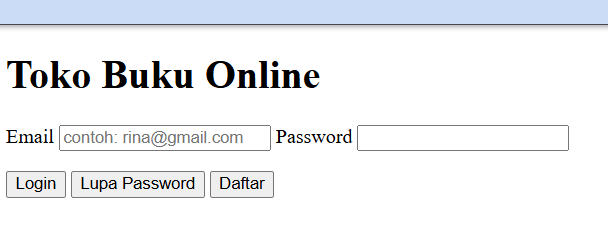

*Gambar 1 - Halaman login, HTML saja*

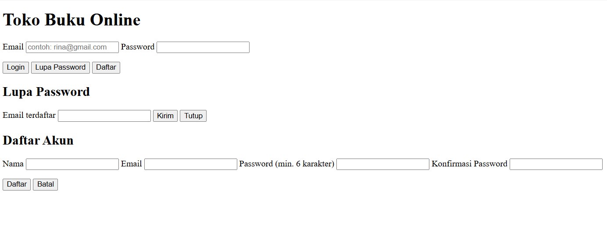

*Gambar 3 - Modal Lupa Password dan Daftar masih tampil semua karena CSS belum ada*


### 3.2 Dashboard (`dashboard.html`)

```html
<!DOCTYPE html>
<html lang="id">
<head>
    <meta charset="UTF-8">
    <meta name="viewport" content="width=device-width, initial-scale=1.0">
    <title>Dashboard - Toko Buku Online</title>
    <link rel="stylesheet" href="css/style.css">
</head>
<body data-page="dashboard">
    <header>
    <strong>Toko Buku Online</strong>
    <nav>
        <a href="dashboard.html">Dashboard</a>
        <a href="stok.html">Katalog</a>
        <a href="checkout.html">Pemesanan</a>
        <a href="tracking.html">Tracking</a>
        <a href="#" id="btnLogout">Logout</a>
    </nav>
</header>
    <main>
        <section>
            <h1 id="greeting"></h1>
            <p>Silakan pilih menu di bawah ini.</p>
        </section>
        <section class="menu">
            <a class="btn" href="stok.html">Informasi Stok / Katalog</a>
            <a class="btn" href="tracking.html">Tracking Pengiriman</a>
            <a class="btn" href="checkout.html">Laporan Pemesanan</a>
            <button type="button" id="btnHistory">History Transaksi</button>
        </section>
    </main>

    <div class="modal" id="modalHistory">
        <div class="modal-content">
            <h2>History Transaksi</h2>
            <ul id="isiHistory"></ul>
            <button type="button" class="secondary" id="tutupHistory">Tutup</button>
        </div>
    </div>
    <footer><p>UTS Pemrograman Web</p></footer>
    <script src="js/data.js"></script>
    <script src="js/script.js"></script>
</body>
</html>
```

### 3.3 Stok / Katalog (`stok.html`)

```html
<!DOCTYPE html>
<html lang="id">
<head>
    <meta charset="UTF-8">
    <meta name="viewport" content="width=device-width, initial-scale=1.0">
    <title>Katalog Stok - Toko Buku Online</title>
    <link rel="stylesheet" href="css/style.css">
</head>
<body data-page="stok">
    <header>
    <strong>Toko Buku Online</strong>
    <nav>
        <a href="dashboard.html">Dashboard</a>
        <a href="stok.html">Katalog</a>
        <a href="checkout.html">Pemesanan</a>
        <a href="tracking.html">Tracking</a>
        <a href="#" id="btnLogout">Logout</a>
    </nav>
</header>
    <main>
        <section>
            <h1>Informasi Stok / Katalog</h1>
            <div class="scroll">
                <table>
                    <thead>
                        <tr>
                            <th>Cover</th><th>Kode</th><th>Nama Barang</th><th>Jenis</th>
                            <th>Edisi</th><th>Stok</th><th>Harga</th>
                        </tr>
                    </thead>
                    <tbody id="isiTabel"></tbody>
                </table>
            </div>
        </section>

        <section>
            <h2>Tambah Stok Baru</h2>
            <form id="formStok" novalidate>
                <div class="row2">
                    <div><label for="kode">Kode Barang</label><input type="text" id="kode"></div>
                    <div><label for="nama">Nama Barang</label><input type="text" id="nama"></div>
                    <div><label for="jenis">Jenis Barang</label><input type="text" id="jenis" value="Buku Ajar"></div>
                    <div><label for="edisi">Edisi</label><input type="number" id="edisi" min="1"></div>
                    <div><label for="stok">Stok</label><input type="number" id="stok" min="0"></div>
                    <div><label for="harga">Harga (angka, contoh 180000)</label><input type="number" id="harga" min="0"></div>
                </div>
                <p class="error" id="pesanStok"></p>
                <button type="submit">Tambah</button>
            </form>
        </section>
    </main>
    <footer><p>UTS Pemrograman Web</p></footer>
    <script src="js/data.js"></script>
    <script src="js/script.js"></script>
</body>
</html>
```

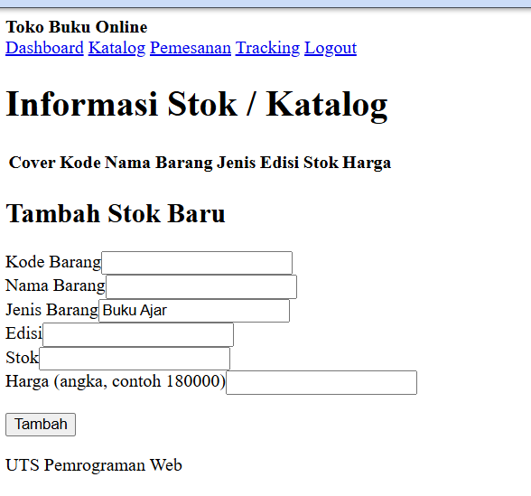

*Gambar 4 - Halaman stok, HTML saja*


### 3.4 Pemesanan (`checkout.html`)

```html
<!DOCTYPE html>
<html lang="id">
<head>
    <meta charset="UTF-8">
    <meta name="viewport" content="width=device-width, initial-scale=1.0">
    <title>Pemesanan - Toko Buku Online</title>
    <link rel="stylesheet" href="css/style.css">
</head>
<body data-page="checkout">
    <header>
    <strong>Toko Buku Online</strong>
    <nav>
        <a href="dashboard.html">Dashboard</a>
        <a href="stok.html">Katalog</a>
        <a href="checkout.html">Pemesanan</a>
        <a href="tracking.html">Tracking</a>
        <a href="#" id="btnLogout">Logout</a>
    </nav>
</header>
    <main>
        <section>
            <h1>Pemesanan Buku</h1>
            <div class="row2">
                <div>
                    <label for="pilihBuku">Pilih Buku</label>
                    <select id="pilihBuku"></select>
                </div>
                <div>
                    <label for="jumlah">Jumlah</label>
                    <input type="number" id="jumlah" min="1" value="1">
                </div>
            </div>
            <button type="button" id="btnTambah">Tambah ke Pesanan</button>
        </section>

        <section>
            <h2>Data Pesanan</h2>
            <div class="scroll">
                <table>
                    <thead>
                        <tr><th>Buku</th><th>Harga</th><th>Jumlah</th><th>Subtotal</th><th>Aksi</th></tr>
                    </thead>
                    <tbody id="isiKeranjang"></tbody>
                    <tfoot>
                        <tr><th colspan="3">Total</th><th colspan="2" id="totalBayar">Rp 0</th></tr>
                    </tfoot>
                </table>
            </div>
        </section>

        <section>
            <h2>Data Pemesan dan Pembayaran</h2>
            <form id="formPesan" novalidate>
                <label for="namaPemesan">Nama Pemesan</label>
                <input type="text" id="namaPemesan">
                <label for="emailPemesan">Email</label>
                <input type="email" id="emailPemesan">
                <label for="telp">No. Telepon</label>
                <input type="text" id="telp">
                <label for="alamat">Alamat Pengiriman</label>
                <textarea id="alamat" rows="3"></textarea>
                <label for="metode">Metode Pembayaran</label>
                <select id="metode">
                    <option value="">-- Pilih --</option>
                    <option>Transfer Bank</option>
                    <option>E-Wallet</option>
                    <option>Kartu Kredit</option>
                </select>
                <p class="error" id="pesanCheckout"></p>
                <button type="submit">Buat Pesanan</button>
            </form>
        </section>
    </main>
    <footer><p>UTS Pemrograman Web</p></footer>
    <script src="js/data.js"></script>
    <script src="js/script.js"></script>
</body>
</html>
```

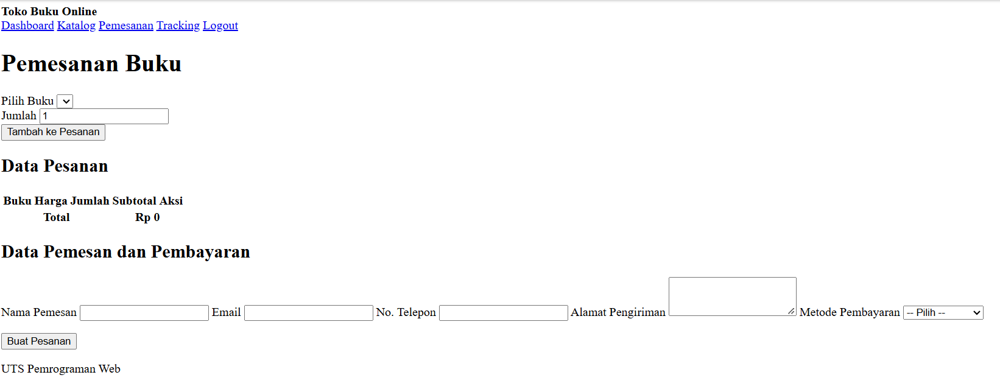

*Gambar 5 - Halaman pemesanan, HTML saja*


### 3.5 Tracking (`tracking.html`)

```html
<!DOCTYPE html>
<html lang="id">
<head>
    <meta charset="UTF-8">
    <meta name="viewport" content="width=device-width, initial-scale=1.0">
    <title>Tracking - Toko Buku Online</title>
    <link rel="stylesheet" href="css/style.css">
</head>
<body data-page="tracking">
    <header>
    <strong>Toko Buku Online</strong>
    <nav>
        <a href="dashboard.html">Dashboard</a>
        <a href="stok.html">Katalog</a>
        <a href="checkout.html">Pemesanan</a>
        <a href="tracking.html">Tracking</a>
        <a href="#" id="btnLogout">Logout</a>
    </nav>
</header>
    <main>
        <section>
            <h1>Informasi Pengiriman</h1>
            <form id="formCari" novalidate>
                <label for="nomorDO">Nomor Delivery Order</label>
                <input type="text" id="nomorDO" placeholder="contoh: 20230012">
                <button type="submit">Cari</button>
            </form>
        </section>

        <section id="hasil" hidden>
            <h2>Hasil Pencarian</h2>
            <dl>
                <dt>Nama Pemesan</dt><dd id="tNama"></dd>
                <dt>Status</dt><dd id="tStatus"></dd>
                <dt>Ekspedisi</dt><dd id="tEkspedisi"></dd>
                <dt>Tanggal Kirim</dt><dd id="tTanggal"></dd>
                <dt>Jenis Paket</dt><dd id="tPaket"></dd>
                <dt>Total Pembayaran</dt><dd id="tTotal"></dd>
            </dl>
            <div class="progress"><div id="tBar"></div></div>
            <h2>Riwayat Perjalanan</h2>
            <ul class="timeline" id="tPerjalanan"></ul>
        </section>
    </main>
    <footer><p>UTS Pemrograman Web</p></footer>
    <script src="js/data.js"></script>
    <script src="js/script.js"></script>
</body>
</html>
```

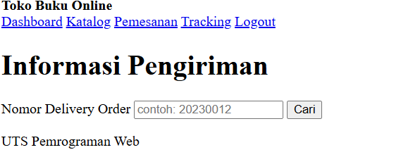

*Gambar 6 - Halaman tracking, HTML saja*


---

## Langkah 4 - Desain dengan CSS (`css/style.css`)

Satu file CSS eksternal dipakai semua halaman. Desainnya sederhana: abu-abu, hitam, putih. `.modal` disembunyikan secara default dan baru tampil saat diberi class `show`.

```css
* { box-sizing: border-box; }
body { font-family: Arial, sans-serif; margin: 0; background: #f4f4f4; color: #222; line-height: 1.5; }

header { background: #333; color: #fff; padding: 12px 24px; display: flex; justify-content: space-between; align-items: center; flex-wrap: wrap; }
header a { color: #fff; text-decoration: none; margin-left: 16px; }
header a:hover { text-decoration: underline; }
footer { text-align: center; padding: 16px; color: #666; font-size: 13px; }

main { max-width: 900px; margin: 24px auto; padding: 0 16px; }
section { background: #fff; border: 1px solid #ccc; border-radius: 4px; padding: 20px; margin-bottom: 20px; }
h1 { margin-top: 0; font-size: 24px; }
h2 { margin-top: 0; font-size: 18px; }

label { display: block; margin: 10px 0 4px; font-weight: bold; font-size: 14px; }
input, select, textarea { width: 100%; padding: 8px; border: 1px solid #999; border-radius: 4px; font-size: 14px; font-family: inherit; }
button, .btn { background: #333; color: #fff; border: none; padding: 9px 16px; border-radius: 4px; cursor: pointer; text-decoration: none; display: inline-block; font-size: 14px; margin-top: 12px; text-align: center; }
button:hover, .btn:hover { background: #555; }
button.secondary { background: #fff; color: #333; border: 1px solid #333; }
button.secondary:hover { background: #eee; }
.error { color: #b00020; font-size: 13px; min-height: 18px; margin: 6px 0 0; }

.login-box { max-width: 380px; margin: 60px auto; }
.menu { display: grid; grid-template-columns: repeat(2, 1fr); gap: 12px; }
.menu .btn, .menu button { margin: 0; padding: 22px; font-size: 16px; }
.row2 { display: grid; grid-template-columns: 1fr 1fr; gap: 12px; }

table { width: 100%; border-collapse: collapse; }
th, td { border: 1px solid #ccc; padding: 8px; text-align: left; font-size: 14px; }
th { background: #eee; }
td img { width: 50px; display: block; }
td input { width: 70px; }
.scroll { overflow-x: auto; }

.modal { display: none; position: fixed; top: 0; left: 0; right: 0; bottom: 0; background: rgba(0,0,0,0.5); align-items: center; justify-content: center; z-index: 10; }
.modal.show { display: flex; }
.modal-content { background: #fff; padding: 20px; width: 90%; max-width: 380px; border-radius: 4px; max-height: 90vh; overflow-y: auto; }

.progress { background: #ddd; height: 16px; border-radius: 8px; overflow: hidden; margin: 8px 0 16px; }
.progress div { background: #333; height: 100%; }
.timeline { list-style: none; padding: 0; margin: 0; }
.timeline li { border-left: 3px solid #333; padding: 2px 0 14px 12px; font-size: 14px; }
.timeline small { color: #666; display: block; }
dl { display: grid; grid-template-columns: 140px 1fr; gap: 6px; margin: 0 0 12px; }
dt { font-weight: bold; }
dd { margin: 0; }

@media (max-width: 600px) {
    .menu, .row2 { grid-template-columns: 1fr; }
    dl { grid-template-columns: 110px 1fr; }
}
```

Setelah CSS dipasang, tampilan berubah. Greeting dan pilihan buku masih kosong karena JavaScript belum dibuat, itu normal.

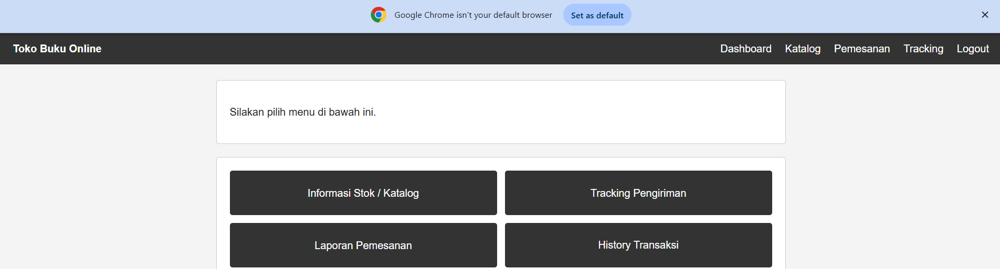

*Gambar 7 - Dashboard setelah CSS (greeting masih kosong)*

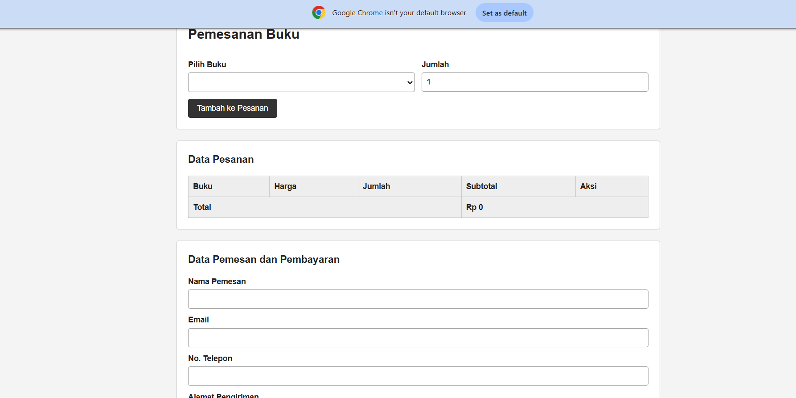

*Gambar 8 - Pemesanan setelah CSS (pilihan buku masih kosong)*

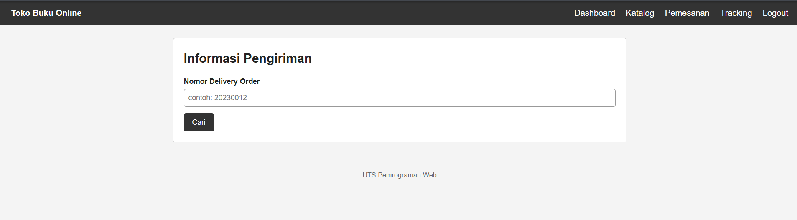

*Gambar 9 - Tracking setelah CSS*


---

## Langkah 5 - JavaScript (`js/script.js`)

Semua kode ditulis bertahap di satu file `script.js`. Bagian baru selalu ditaruh **di atas** bagian penghubung (5.6).

### 5.1 Fungsi bantu

```javascript
// ===== BAGIAN 1: FUNGSI BANTU =====
function $(id) {
    return document.getElementById(id);
}

function getPengguna() {
    var baru = JSON.parse(localStorage.getItem("penggunaBaru")) || [];
    return dataPengguna.concat(baru);
}

function bukaModal(id) {
    $(id).classList.add("show");
}

function tutupModal(id) {
    $(id).classList.remove("show");
}

function cekLogin() {
    var user = JSON.parse(sessionStorage.getItem("userLogin"));
    if (!user) {
        window.location.href = "index.html";
    }
    return user;
}

function logout() {
    sessionStorage.removeItem("userLogin");
    window.location.href = "index.html";
}

function formatRupiah(angka) {
    return "Rp " + angka.toLocaleString("id-ID");
}

function angkaDariHarga(teks) {
    return parseInt(teks.replace(/[^0-9]/g, ""));
}
```

### 5.2 Logika Login

```javascript
// ===== BAGIAN 2: HALAMAN LOGIN =====
function initLogin() {
    // --- Login ---
    $("formLogin").addEventListener("submit", function (e) {
        e.preventDefault();
        var email = $("email").value.trim();
        var password = $("password").value;

        if (email === "" || password === "") {
            $("pesanLogin").textContent = "Email dan password wajib diisi.";
            return;
        }

        var user = getPengguna().find(function (u) {
            return u.email === email && u.password === password;
        });

        if (user) {
            sessionStorage.setItem("userLogin", JSON.stringify(user));
            window.location.href = "dashboard.html";
        } else {
            $("pesanLogin").textContent = "";
            alert("Email/password yang anda masukkan salah");
        }
    });

    // --- Buka & tutup modal ---
    $("btnLupa").onclick = function () { bukaModal("modalLupa"); };
    $("btnDaftar").onclick = function () { bukaModal("modalDaftar"); };
    $("tutupLupa").onclick = function () { tutupModal("modalLupa"); };
    $("tutupDaftar").onclick = function () { tutupModal("modalDaftar"); };

    // --- Lupa password ---
    $("formLupa").addEventListener("submit", function (e) {
        e.preventDefault();
        var email = $("emailLupa").value.trim();
        var ada = getPengguna().some(function (u) { return u.email === email; });

        if (ada) {
            alert("Link reset password sudah dikirim ke " + email);
            $("formLupa").reset();
            tutupModal("modalLupa");
        } else {
            alert("Email tidak terdaftar.");
        }
    });

    // --- Daftar ---
    $("formDaftar").addEventListener("submit", function (e) {
        e.preventDefault();
        var nama = $("namaDaftar").value.trim();
        var email = $("emailDaftar").value.trim();
        var pass = $("passDaftar").value;
        var konf = $("konfDaftar").value;
        var pesan = $("pesanDaftar");
        var polaEmail = /^[^\s@]+@[^\s@]+\.[^\s@]+$/;

        if (nama === "" || email === "" || pass === "") {
            pesan.textContent = "Semua kolom wajib diisi.";
        } else if (!polaEmail.test(email)) {
            pesan.textContent = "Format email tidak valid.";
        } else if (pass.length < 6) {
            pesan.textContent = "Password minimal 6 karakter.";
        } else if (pass !== konf) {
            pesan.textContent = "Konfirmasi password tidak sama.";
        } else if (getPengguna().some(function (u) { return u.email === email; })) {
            pesan.textContent = "Email sudah terdaftar.";
        } else {
            var baru = JSON.parse(localStorage.getItem("penggunaBaru")) || [];
            baru.push({ id: getPengguna().length + 1, nama: nama, email: email, password: pass, role: "User" });
            localStorage.setItem("penggunaBaru", JSON.stringify(baru));
            alert("Pendaftaran berhasil. Silakan login.");
            pesan.textContent = "";
            $("formDaftar").reset();
            tutupModal("modalDaftar");
        }
    });
}
```

### 5.3 Penghubung (paling bawah file)

Menentukan fungsi mana yang berjalan sesuai atribut `data-page` pada `<body>`.

```javascript
// ===== BAGIAN 7: PENGHUBUNG (taruh paling bawah) =====
document.addEventListener("DOMContentLoaded", function () {
    var halaman = document.body.dataset.page;

    var btnLogout = $("btnLogout");
    if (btnLogout) {
        btnLogout.onclick = function (e) {
            e.preventDefault();
            logout();
        };
    }

    if (halaman === "login") initLogin();
    if (halaman === "dashboard") initDashboard();
    if (halaman === "stok") initStok();
    if (halaman === "checkout") initCheckout();
    if (halaman === "tracking") initTracking();
});
```

**Hasil:** login dengan data salah memunculkan alert, tombol Lupa Password membuka modal.

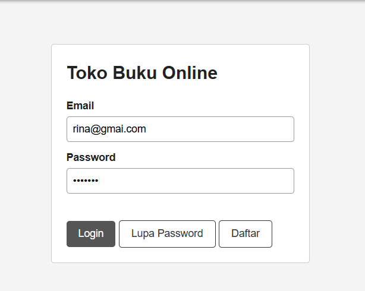

*Gambar 10 - Mengisi login dengan email yang salah*

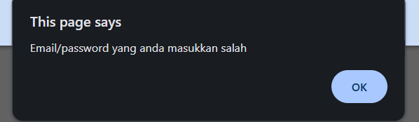

*Gambar 11 - Alert "Email/password yang anda masukkan salah"*

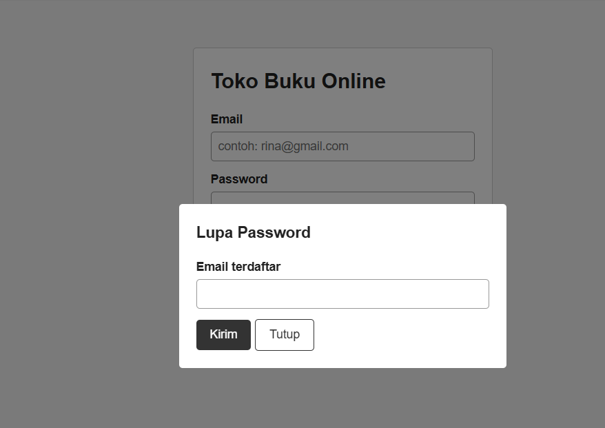

*Gambar 13 - Modal Lupa Password*


### 5.4 Dashboard

```javascript
// ===== BAGIAN 3: HALAMAN DASHBOARD =====
function initDashboard() {
    var user = cekLogin();

    // Greeting berdasarkan jam lokal
    var jam = new Date().getHours();
    var sapaan = "Selamat malam";
    if (jam < 11) {
        sapaan = "Selamat pagi";
    } else if (jam < 15) {
        sapaan = "Selamat siang";
    } else if (jam < 18) {
        sapaan = "Selamat sore";
    }
    $("greeting").textContent = sapaan + ", " + user.nama + " (" + user.role + ")";

    // History transaksi (modal)
    $("btnHistory").onclick = function () {
        var riwayat = JSON.parse(localStorage.getItem("riwayat")) || [];
        var daftar = $("isiHistory");
        daftar.innerHTML = "";

        if (riwayat.length === 0) {
            var kosong = document.createElement("li");
            kosong.textContent = "Belum ada transaksi.";
            daftar.appendChild(kosong);
        }
        riwayat.forEach(function (r) {
            var li = document.createElement("li");
            li.textContent = r.nomorDO + " - " + r.nama + " - " + r.tanggal + " - " + formatRupiah(r.total) + " (" + r.metode + ")";
            daftar.appendChild(li);
        });
        bukaModal("modalHistory");
    };
    $("tutupHistory").onclick = function () { tutupModal("modalHistory"); };
}
```

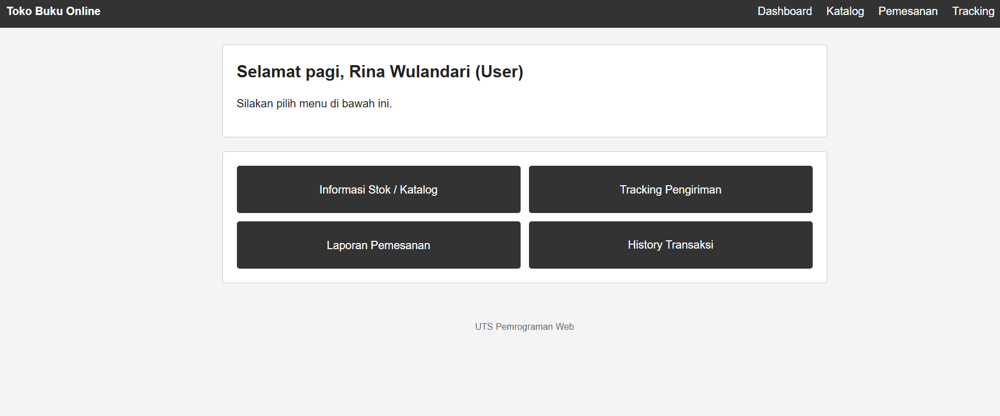

*Gambar 12 - Dashboard setelah login, lengkap dengan greeting sesuai jam*


### 5.5 Stok / Katalog

```javascript
// ===== BAGIAN 4: HALAMAN STOK / KATALOG =====
function buatBaris(b) {
    var tr = document.createElement("tr");

    var tdCover = document.createElement("td");
    if (b.cover) {
        var img = document.createElement("img");
        img.src = b.cover;
        img.alt = b.namaBarang;
        tdCover.appendChild(img);
    } else {
        tdCover.textContent = "-";
    }
    tr.appendChild(tdCover);

    [b.kodeBarang, b.namaBarang, b.jenisBarang, b.edisi, b.stok, b.harga].forEach(function (isi) {
        var td = document.createElement("td");
        td.textContent = isi;
        tr.appendChild(td);
    });
    return tr;
}

function initStok() {
    cekLogin();
    var tbody = $("isiTabel");

    // Tampilkan data dari data.js
    dataKatalogBuku.forEach(function (b) {
        tbody.appendChild(buatBaris(b));
    });

    // Tambah baris stok baru
    $("formStok").addEventListener("submit", function (e) {
        e.preventDefault();
        var kode = $("kode").value.trim();
        var nama = $("nama").value.trim();
        var jenis = $("jenis").value.trim();
        var edisi = $("edisi").value;
        var stok = $("stok").value;
        var harga = $("harga").value;
        var pesan = $("pesanStok");

        if (kode === "" || nama === "" || jenis === "" || edisi === "" || stok === "" || harga === "") {
            pesan.textContent = "Semua kolom wajib diisi.";
            return;
        }
        if (parseInt(stok) < 0 || parseInt(harga) <= 0) {
            pesan.textContent = "Stok tidak boleh minus dan harga harus lebih dari 0.";
            return;
        }
        var kembar = dataKatalogBuku.some(function (b) { return b.kodeBarang === kode; });
        if (kembar) {
            pesan.textContent = "Kode barang sudah ada.";
            return;
        }

        var bukuBaru = {
            kodeBarang: kode,
            namaBarang: nama,
            jenisBarang: jenis,
            edisi: edisi,
            stok: parseInt(stok),
            harga: formatRupiah(parseInt(harga)),
            cover: ""
        };
        dataKatalogBuku.push(bukuBaru);
        tbody.appendChild(buatBaris(bukuBaru));

        pesan.textContent = "";
        $("formStok").reset();
        $("jenis").value = "Buku Ajar";
        alert("Stok baru berhasil ditambahkan.");
    });
}
```

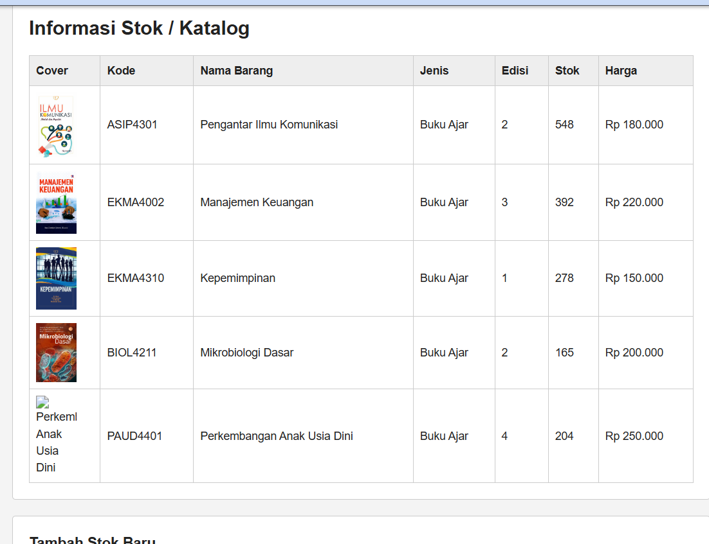

*Gambar 14 - Tabel katalog dibuat dari data.js dengan JavaScript DOM*


### 5.6 Pemesanan

```javascript
// ===== BAGIAN 5: HALAMAN PEMESANAN =====
var keranjang = [];

function renderKeranjang() {
    var tbody = $("isiKeranjang");
    tbody.innerHTML = "";
    var total = 0;

    if (keranjang.length === 0) {
        var trKosong = document.createElement("tr");
        var tdKosong = document.createElement("td");
        tdKosong.colSpan = 5;
        tdKosong.textContent = "Belum ada buku dipilih.";
        trKosong.appendChild(tdKosong);
        tbody.appendChild(trKosong);
    }

    keranjang.forEach(function (item, i) {
        var subtotal = item.harga * item.jumlah;
        total += subtotal;
        var tr = document.createElement("tr");

        var tdNama = document.createElement("td");
        tdNama.textContent = item.nama;
        var tdHarga = document.createElement("td");
        tdHarga.textContent = formatRupiah(item.harga);

        // Kolom jumlah: bisa diubah langsung
        var tdJumlah = document.createElement("td");
        var input = document.createElement("input");
        input.type = "number";
        input.min = 1;
        input.value = item.jumlah;
        input.addEventListener("change", function () {
            var j = parseInt(input.value);
            if (isNaN(j) || j < 1) {
                alert("Jumlah minimal 1.");
                input.value = item.jumlah;
            } else if (j > item.stok) {
                alert("Jumlah melebihi stok (" + item.stok + ").");
                input.value = item.jumlah;
            } else {
                item.jumlah = j;
                renderKeranjang();
            }
        });
        tdJumlah.appendChild(input);

        var tdSub = document.createElement("td");
        tdSub.textContent = formatRupiah(subtotal);

        var tdAksi = document.createElement("td");
        var btnHapus = document.createElement("button");
        btnHapus.type = "button";
        btnHapus.className = "secondary";
        btnHapus.textContent = "Hapus";
        btnHapus.style.marginTop = "0";
        btnHapus.onclick = function () {
            keranjang.splice(i, 1);
            renderKeranjang();
        };
        tdAksi.appendChild(btnHapus);

        [tdNama, tdHarga, tdJumlah, tdSub, tdAksi].forEach(function (td) { tr.appendChild(td); });
        tbody.appendChild(tr);
    });

    $("totalBayar").textContent = formatRupiah(total);
}

function initCheckout() {
    var user = cekLogin();
    $("namaPemesan").value = user.nama;
    $("emailPemesan").value = user.email;

    // Isi pilihan buku dari data.js
    var pilih = $("pilihBuku");
    dataKatalogBuku.forEach(function (b, i) {
        var opt = document.createElement("option");
        opt.value = i;
        opt.textContent = b.namaBarang + " - " + b.harga;
        pilih.appendChild(opt);
    });

    renderKeranjang();

    // Tambah ke pesanan
    $("btnTambah").onclick = function () {
        var buku = dataKatalogBuku[pilih.value];
        var jumlah = parseInt($("jumlah").value);

        if (isNaN(jumlah) || jumlah < 1) {
            alert("Jumlah minimal 1.");
            return;
        }
        var ada = keranjang.find(function (k) { return k.kode === buku.kodeBarang; });
        var jumlahBaru = jumlah + (ada ? ada.jumlah : 0);
        if (jumlahBaru > buku.stok) {
            alert("Jumlah melebihi stok (" + buku.stok + ").");
            return;
        }

        if (ada) {
            ada.jumlah = jumlahBaru;
        } else {
            keranjang.push({
                kode: buku.kodeBarang,
                nama: buku.namaBarang,
                harga: angkaDariHarga(buku.harga),
                stok: buku.stok,
                jumlah: jumlah
            });
        }
        $("jumlah").value = 1;
        renderKeranjang();
    };

    // Kirim pesanan
    $("formPesan").addEventListener("submit", function (e) {
        e.preventDefault();
        var nama = $("namaPemesan").value.trim();
        var email = $("emailPemesan").value.trim();
        var telp = $("telp").value.trim();
        var alamat = $("alamat").value.trim();
        var metode = $("metode").value;
        var pesan = $("pesanCheckout");

        if (keranjang.length === 0) {
            pesan.textContent = "Pilih minimal satu buku terlebih dahulu.";
        } else if (nama === "" || email === "" || telp === "" || alamat === "" || metode === "") {
            pesan.textContent = "Semua data pemesan dan pembayaran wajib diisi.";
        } else if (!/^[0-9]{10,13}$/.test(telp)) {
            pesan.textContent = "No. telepon harus berupa angka 10-13 digit.";
        } else {
            var total = keranjang.reduce(function (t, k) { return t + k.harga * k.jumlah; }, 0);
            var nomorDO = "2026" + Math.floor(1000 + Math.random() * 9000);

            var riwayat = JSON.parse(localStorage.getItem("riwayat")) || [];
            riwayat.push({
                nomorDO: nomorDO,
                nama: nama,
                tanggal: new Date().toLocaleDateString("id-ID"),
                total: total,
                metode: metode
            });
            localStorage.setItem("riwayat", JSON.stringify(riwayat));

            alert("Pesanan berhasil dibuat.\nNomor DO: " + nomorDO + "\nTotal: " + formatRupiah(total));
            pesan.textContent = "";
            keranjang = [];
            renderKeranjang();
            $("telp").value = "";
            $("alamat").value = "";
            $("metode").value = "";
        }
    });
}
```

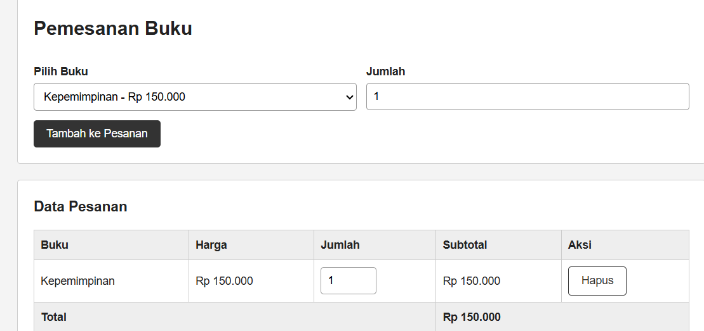

*Gambar 15 - Buku ditambahkan ke pesanan, total terhitung otomatis*

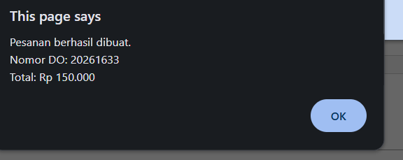

*Gambar 16 - Alert pesanan berhasil beserta Nomor DO*

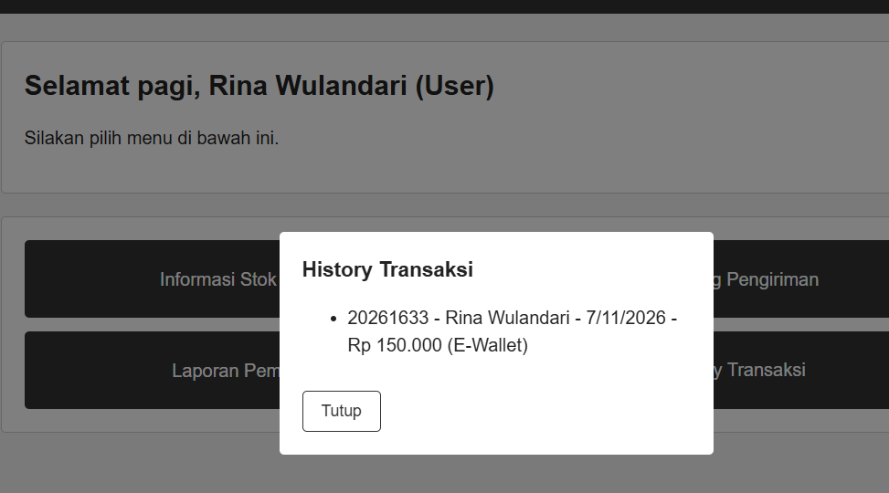

*Gambar 17 - Modal History Transaksi di dashboard berisi pesanan tadi*


### 5.7 Tracking

Nomor DO dari checkout juga bisa dicari di sini (status "Diproses"), karena fungsi `cariDiRiwayat` membaca riwayat pesanan.

```javascript
// ===== BAGIAN 6: HALAMAN TRACKING =====
// Pesanan baru dari checkout (tersimpan di localStorage) ikut bisa dilacak
function cariDiRiwayat(nomor) {
    var riwayat = JSON.parse(localStorage.getItem("riwayat")) || [];
    var r = riwayat.find(function (x) { return x.nomorDO === nomor; });
    if (!r) {
        return null;
    }
    return {
        nomorDO: r.nomorDO,
        nama: r.nama,
        status: "Diproses",
        ekspedisi: "JNE",
        tanggalKirim: r.tanggal,
        paket: "Reguler",
        total: formatRupiah(r.total),
        perjalanan: [
            { waktu: r.tanggal, keterangan: "Pesanan diterima dan sedang diproses" }
        ]
    };
}

function initTracking() {
    cekLogin();

    $("formCari").addEventListener("submit", function (e) {
        e.preventDefault();
        var nomor = $("nomorDO").value.trim();

        if (nomor === "") {
            alert("Nomor Delivery Order wajib diisi.");
            return;
        }

        var d = dataTracking[nomor] || cariDiRiwayat(nomor);
        if (!d) {
            $("hasil").hidden = true;
            alert("Nomor DO " + nomor + " tidak ditemukan.");
            return;
        }

        $("tNama").textContent = d.nama;
        $("tStatus").textContent = d.status;
        $("tEkspedisi").textContent = d.ekspedisi;
        $("tTanggal").textContent = d.tanggalKirim;
        $("tPaket").textContent = d.paket;
        $("tTotal").textContent = d.total;

        // Progress bar berdasarkan status
        var persen = { "Diproses": 20, "Dalam Perjalanan": 60, "Dikirim": 100 };
        $("tBar").style.width = (persen[d.status] || 30) + "%";

        // Riwayat perjalanan
        var daftar = $("tPerjalanan");
        daftar.innerHTML = "";
        d.perjalanan.forEach(function (p) {
            var li = document.createElement("li");
            li.textContent = p.keterangan;
            var waktu = document.createElement("small");
            waktu.textContent = p.waktu;
            li.appendChild(waktu);
            daftar.appendChild(li);
        });

        $("hasil").hidden = false;
    });
}
```

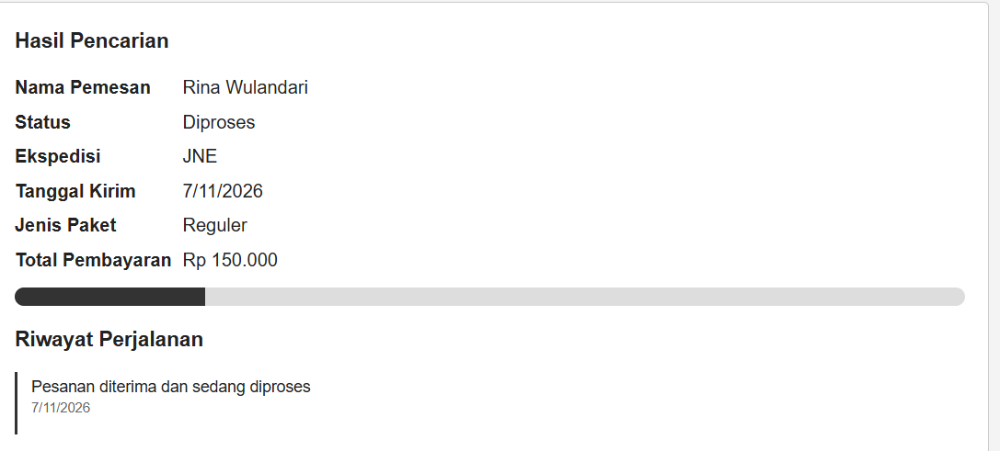

*Gambar 18 - Hasil pencarian tracking: data pemesan, status, progress bar, dan riwayat perjalanan*


---


